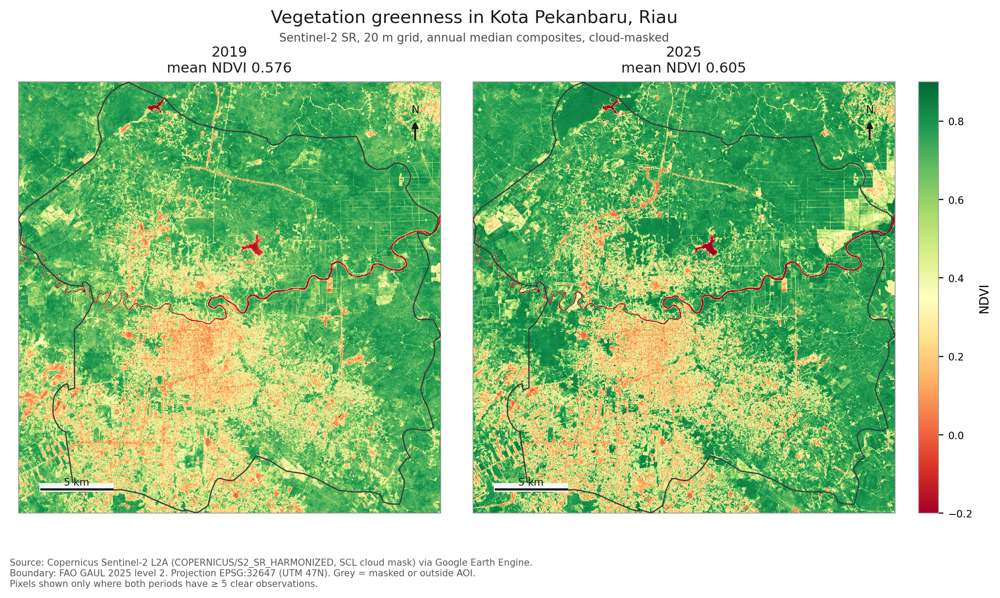
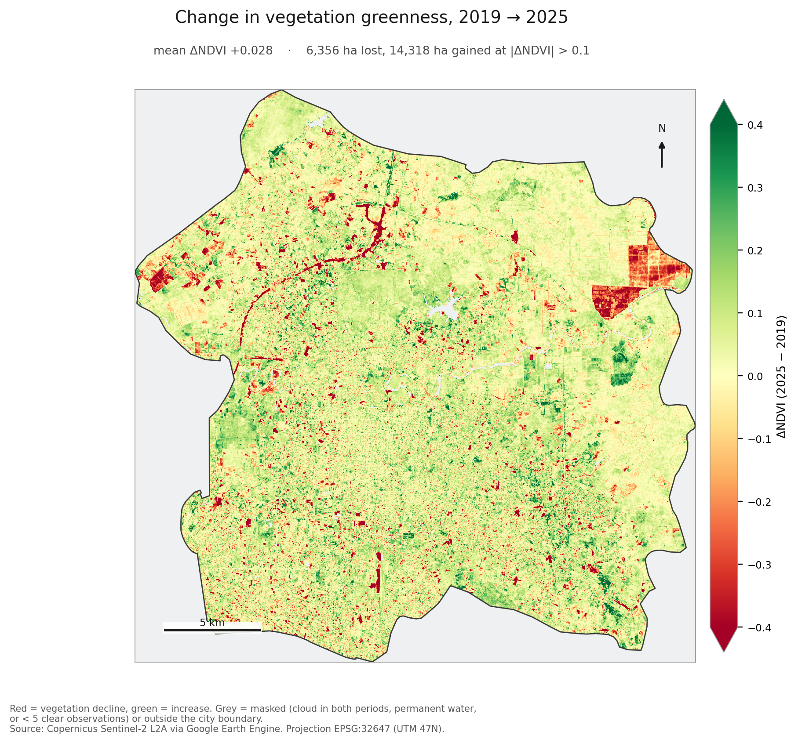
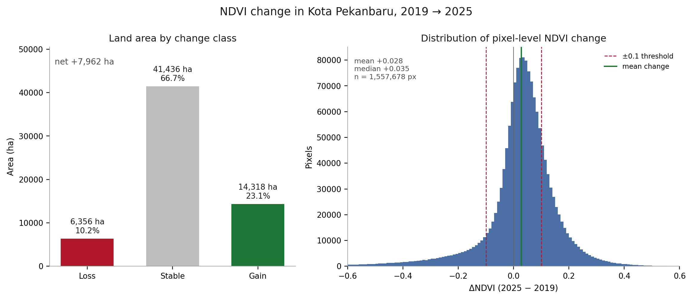
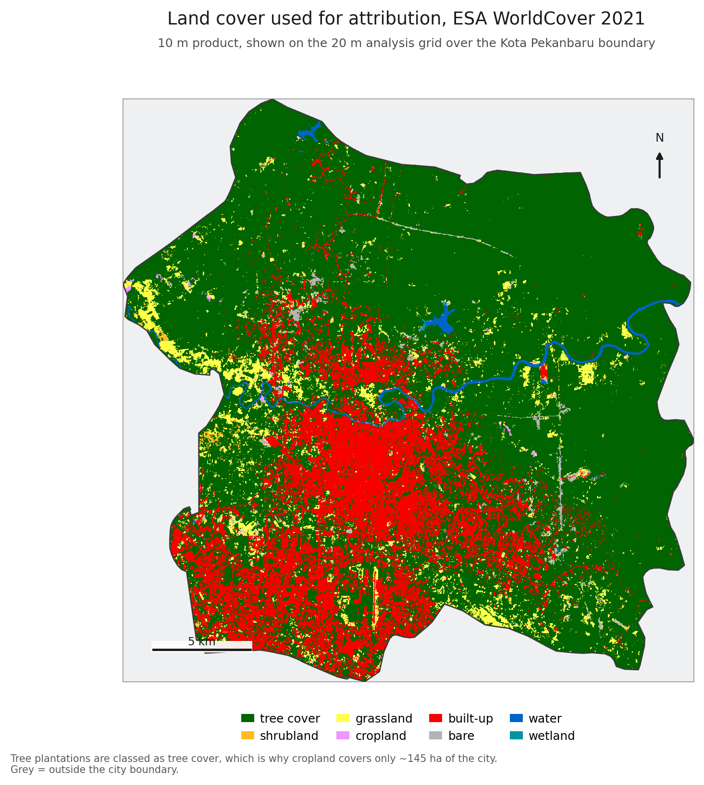
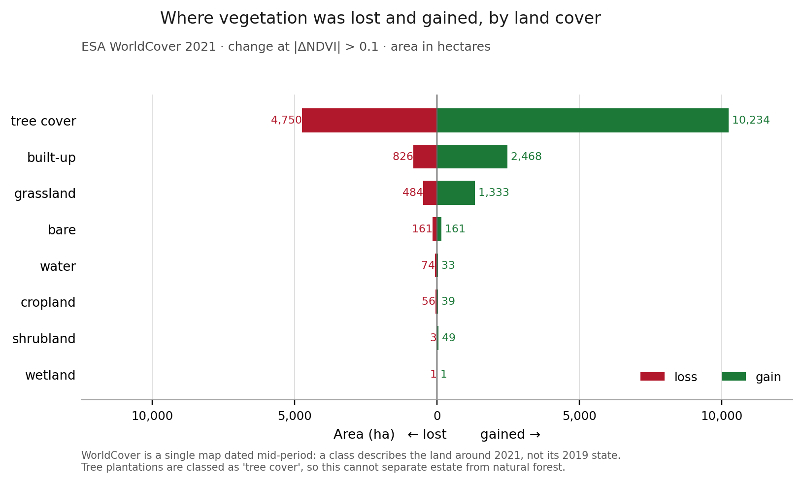
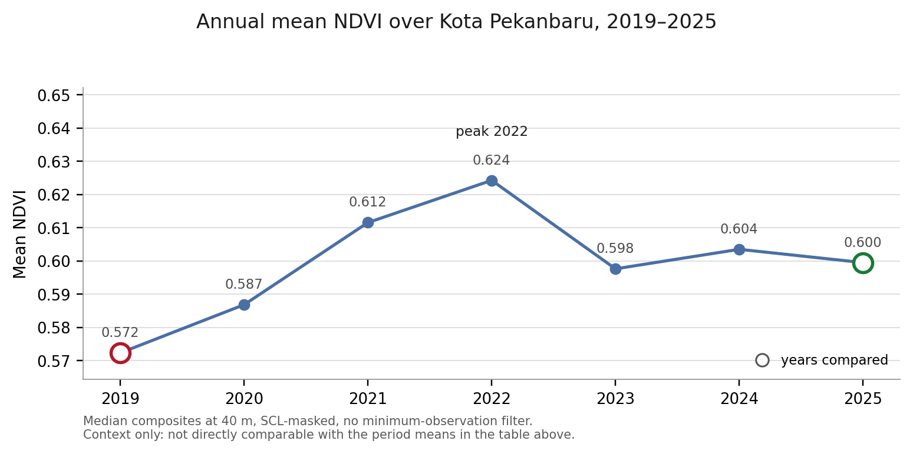
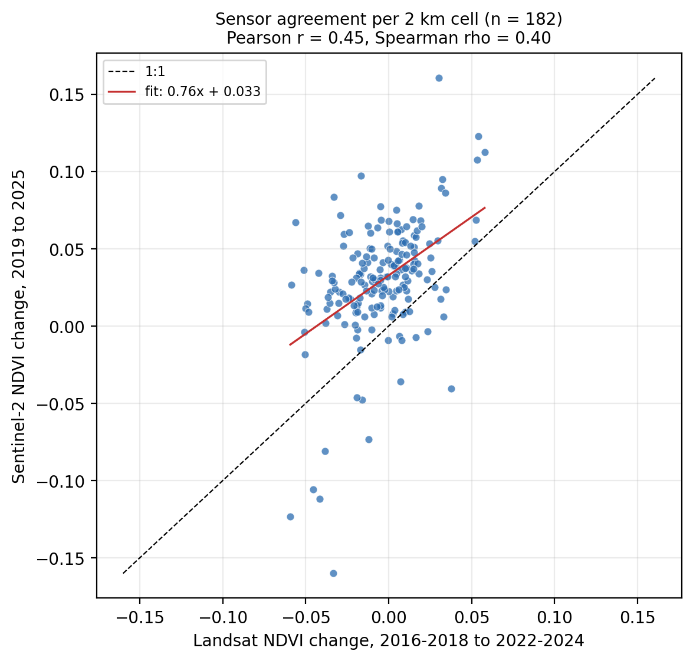

# Vegetation change in Kota Pekanbaru, Riau (2019 → 2025)

How much vegetation cover did Pekanbaru lose and gain, and where? This project builds
cloud-masked Sentinel-2 median NDVI composites for an early and a recent year, differences
them into a change image, and quantifies the result with Earth Engine `reduceRegion`.

**Headline:** mean NDVI rose from **0.576 to 0.605** (+0.028). At a ±0.10 NDVI threshold,
**6,356 ha lost** vegetation, **14,318 ha gained**, and **41,436 ha** stayed stable, a net
**+7,962 ha** across 62,110 ha of analysed land.

| | 2019 | 2025 | Change |
|---|---|---|---|
| Mean NDVI | 0.576 | 0.605 | **+0.028** |
| Median NDVI | 0.668 | 0.707 | +0.039 |
| Std. dev. | 0.213 | 0.232 | n/a |
| Scenes used | 43 | 39 | n/a |

| Class (\|ΔNDVI\| > 0.10) | Area (ha) | Share |
|---|---|---|
| Loss | 6,356 | 10.2% |
| Stable | 41,436 | 66.7% |
| Gain | 14,318 | 23.1% |
| **Net** | **+7,962** | |

Sentinel-2 Level-2A coverage over Pekanbaru begins in December 2018, so 2019 is the
earliest year with a complete record and 2025 the most recent one.

## Figures







Figure 3's histogram is clipped at ±0.6 ΔNDVI to keep the bulk of the distribution legible;
the statistics above use every valid pixel (min −1.03, max +0.88). Figures 4 to 6 appear under
Interpretation.

## Method

Area of interest is **Kota Pekanbaru** (`FAO/GAUL/2025/level2`, `GAUL2_NAME`), 62,884 ha,
projected to **EPSG:32647** (UTM 47N) for all area maths.

1. **Collection.** `COPERNICUS/S2_SR_HARMONIZED`, one calendar year per period, filtered to
   scenes with `CLOUDY_PIXEL_PERCENTAGE < 80`. That scene filter is deliberately loose: the
   real cloud handling is per-pixel, and a strict scene filter throws away scenes that are
   clear over the city but cloudy elsewhere in the tile. 43 scenes remain for 2019, 39 for 2025.
2. **Cloud mask (SCL).** Only SCL classes **4 (vegetation), 5 (not vegetated), 6 (water),
   11 (snow/ice)** are kept. Cloud shadow (3), cloud (8, 9), cirrus (10), saturated/defective
   (1), dark area (2), unclassified (7) and no-data (0) are masked before any NDVI is computed.
3. **Composites.** Per-pixel **median NDVI** for each period, so residual cloud and haze do not
   pull a pixel's value. Each period also carries a **valid-observation count** so cloud gaps
   are visible rather than smoothed over.
4. **Analysis mask.** A pixel must have **≥ 5 clear observations in both periods** and must not
   be **permanent water** (SCL class 6 in more than half of its clear observations in both years).
   Permanent water is excluded so the city mean is a land-only number. This leaves 62,110 ha,
   **98.8% of the city**, with 16.8 and 14.6 clear observations per pixel on average.
5. **Change image.** `ΔNDVI = NDVI_2025 − NDVI_2019` on the 20 m grid.
6. **Quantification.** `reduceRegion` over the boundary gives mean/median/std/min/max and pixel
   counts; class areas come from summing `ee.Image.pixelArea()`, not from pixel counts times a
   nominal pixel size, so they are exact hectares.
7. **Attribution.** Every analysed pixel is labelled with ESA WorldCover 2021
   (`ESA/WorldCover/v200/2021`, 10 m) and the change classes are cross-tabulated against it in a
   single grouped reduction, so the attribution totals reconcile with the headline areas.

**Why 20 m?** SCL, the cloud mask, is natively 20 m. Analysing at 20 m means the mask is an
observation rather than an interpolation of one, and keeps the composite, the change image and
the downloaded rasters on one consistent grid.

## Interpretation

**The city got greener overall, but the change runs both ways.** Net +7,962 ha and +0.028 mean
NDVI, against 6,356 ha that lost vegetation. A single net number hides a 10% loss.

**Greening here is mostly woody regrowth, and this dataset cannot tell plantation from forest.**
Pekanbaru's 62,884 ha is not a dense urban block: much of it is acacia pulpwood and oil-palm
estate and secondary forest on peat, land uses that run on harvest-and-replant cycles and swing
NDVI strongly in both directions between any two dates. The attribution below puts most of both
loss and gain on land mapped as tree cover, which fits that cycle. But ESA WorldCover labels
only about 145 ha of the analysed land as cropland, so **plantations are labelled as tree cover**
and the same numbers would appear if the regrowth were natural forest. Treat plantation rotation as the
likely mechanism, not a measured one.

**Attribution by land cover.**



The city's matrix is tree cover, with built-up land across the centre and south, grassland
scattered mainly along the western edge, and the Siak crossing east to west. Labels come from a
2021 map, which sits between the two dates, so they describe the land around mid-period rather
than its 2019 state.



Tree cover carries most of both sides of the change: **4,750 ha lost, 10,234 ha gained**, net
+5,485 ha. Built-up land shows 2,468 ha of gain against 826 ha of loss, more plausibly canopy
and garden vegetation inside settlements than new buildings, since WorldCover's built-up class
includes vegetated urban surfaces. Bare ground is almost exactly balanced (161 ha each way),
consistent with clearing and revegetation cancelling within a small bare fraction. Cropland
(56 ha lost, 39 ha gained) and wetland (< 2 ha either way) are negligible, and water losing
74 ha while gaining 33 ha is small enough to be bankline and mask-edge effect rather than a
change in the river's course.

**The loss class is real, and checkable.** The largest connected patch of strong loss
(|ΔNDVI| > 0.2) is a 270 ha rectilinear block in the east of the city (101.557 E, 0.592 N),
where composite NDVI fell from 0.701 to 0.509. It had 17.2 and 15.1 clear observations per
pixel in the two periods, so it is a real change, not a cloud gap. Rectilinear edges like that
are the signature of plantation block clearing or thinning, not of gradual urban creep.

**2019 was a low starting point, which inflates the headline.** Running the same median
composite for every year (`outputs/data/annual_ndvi_context.json`) shows the two comparison
years in context:



NDVI climbs from 0.572 to a **2022 peak of 0.624** and then flattens or edges down to 0.600.
Part of the 2019→2025 increase is recovery from a dry, fire-affected 2019 in Riau rather than a
sustained greening trend; the 2022→2025 drop of about 0.025 is the more useful signal for
present-day conditions.

## How much does the window choice matter?

The main comparison uses single calendar years, so it carries the caveat below about
annual rather than seasonally matched windows. As a check, the same idea was run on
Landsat 8/9, whose archive is long enough to compare 2016-2018 with 2022-2024 under two
different windows over the same city boundary (`src/landsat_seasonality.py`):

| Window | Net change | Median | Area losing | Area gaining |
|---|---|---|---|---|
| June to September | -0.004 | -0.004 | 29.0% | 27.4% |
| Full year | -0.008 | -0.004 | 29.5% | 25.0% |

The median change is identical and the loss share moves by half a percentage point, so
the loss signal survives the window choice. The net mean roughly doubles between the two
windows, which is a reminder that a mean of a bimodal change distribution is a weak
summary: it is the balance of two large opposing areas, not a typical pixel.

These are Landsat numbers, not Sentinel-2 numbers, so they do not validate the headline
above. What they do show is that both windows come out slightly negative against a
2016-2018 baseline, which fits the 2019 caveat further up rather than a sustained
greening trend: a low, fire-affected 2019 inflates any comparison that starts there.

## Do two sensors agree on where change happened?

The headline rests on one sensor. A second opinion is available because Landsat 8/9
reaches further back, so the same question can be asked of 2016-2018 against 2022-2024.
Sensors, resolutions and periods differ, so the magnitudes should not match. The spatial
pattern should.

Across 182 cells of 2 km that both rasters cover, the two series correlate at Pearson
r = 0.45 (p = 2e-10) and Spearman rho = 0.40. Cells that lost vegetation in one series
tend to have lost it in the other. The fitted line (slope 0.76, intercept +0.033) puts
Sentinel-2 about 0.03 NDVI higher, which is the period difference rather than a sensor
disagreement: the annual context series already shows 2019 as a low year.

This checks the pattern, not the hectare totals, and it means the loss map is not an
artefact of one sensor's cloud handling or compositing choice.



**Urban expansion shows up as stability, not loss.** The built-up core already had low NDVI in
2019, so converting it further registers as stable-low rather than as change. NDVI difference
detects *change* in greenness; it does not inventory current land cover.

## Limitations

- **The attribution is dated mid-period.** ESA WorldCover 2021 is a single static map from
  between the two periods, so a class describes the land around 2021, not its 2019 state. Land
  cleared in 2020 and regrowing by 2025 is labelled by what it looked like in 2021.
- **Attribution stops at 8 broad classes.** Loss and gain are NDVI deltas, not land-cover
  transitions. A pixel losing 0.3 NDVI could be a cleared plantation, a burned peat dome, or a
  harvested field, and with plantations inside "tree cover" the estate-versus-forest question
  stays open.
- **NDVI saturates in dense canopy** (above roughly 0.8), so additional biomass under closed
  forest is under-represented; the gain class is biased toward low-to-medium cover.
- **Annual, not seasonally matched, windows.** Pekanbaru is near the equator so seasonality is
  weak, but haze events are not seasonal. See the 2019 caveat above, and the Landsat window
  check for how much this moves the numbers.
- **Threshold dependence.** Class areas move with the threshold: ±0.05 gives 9,972 ha loss and
  27,332 ha gain, ±0.15 gives 4,522 ha and 7,086 ha. The sign of the net result does not change.
- **Boundary.** FAO GAUL 2025 is simplified and is an administrative boundary, not a functional
  urban area.
- **2025 has fewer usable scenes** (39 versus 43), which is why the ≥ 5 observation rule exists.

## Reproduce

```bash
conda activate geo          # earthengine-api, geopandas, rasterio, matplotlib
python src/run_analysis.py  # composites, stats, GeoTIFFs   (~4 min, needs EE auth)
python src/make_figures.py  # the six figures
python src/landsat_seasonality.py  # optional seasonal-window check (~2 min)
python src/sensor_agreement.py  # optional cross-sensor check (~3 min)
```

Requires a one-time `earthengine authenticate` and a Google Cloud project in
`src/config.py` (`GEE_PROJECT`). Change `EARLY_YEAR` / `RECENT_YEAR`, `CHANGE_THRESHOLD`,
`SCALE` or `MIN_OBSERVATIONS` there and rerun; nothing else needs editing.

## Files

| Path | Contents |
|---|---|
| `src/config.py` | AOI, periods, thresholds, grid, CRS |
| `src/s2_utils.py` | SCL mask, median composite, NDVI, analysis mask |
| `src/run_analysis.py` | Pipeline, `reduceRegion` statistics, raster download |
| `src/landcover.py` | WorldCover loading, class coding, cross-tab parsing |
| `src/make_figures.py` | The six figures |
| `src/landsat_seasonality.py` | Landsat cross-sensor check of the seasonal window |
| `src/sensor_agreement.py` | Landsat versus Sentinel-2 agreement on a 2 km grid |
| `outputs/data/stats.json` | Every headline number, plus threshold sensitivity and attribution |
| `outputs/data/area_summary.csv` | Loss / stable / gain areas |
| `outputs/data/landcover_attribution.csv` | Those areas split by land-cover class |
| `outputs/data/landsat_seasonality.csv` | Net change under two seasonal windows |
| `outputs/data/sensor_agreement.csv` | NDVI change per cell, both sensors |
| `outputs/data/landcover_worldcover.tif` | WorldCover classes (1–8), 20 m, EPSG:32647 |
| `outputs/data/ndvi_composites.tif` | NDVI for both periods, 20 m, EPSG:32647 |
| `outputs/data/ndvi_change.tif` | ΔNDVI plus the `analysis_mask` band |
| `outputs/data/annual_ndvi_context.json` | 2019–2025 yearly check behind figure 4 |

Masked pixels in the downloaded GeoTIFFs read as **0**, so use the `analysis_mask` band in
`ndvi_change.tif` (1 = valid) rather than testing for zero.

## Data credits

Sentinel-2 L2A © Copernicus / ESA, accessed through Google Earth Engine. Boundary: FAO GAUL
2025. Analysis in EPSG:32647; areas in hectares.
